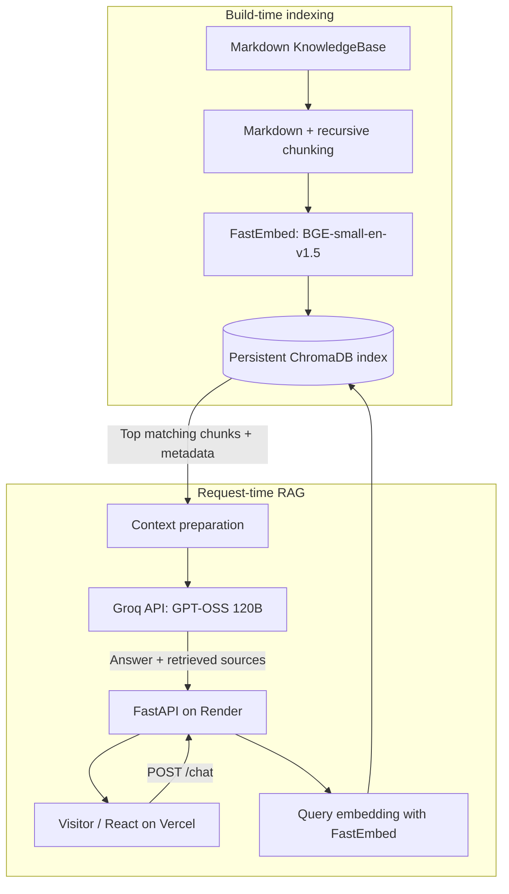

# Tonu James — AI Portfolio with RAG Chatbot

**A deployed, full-stack portfolio website with a Retrieval-Augmented Generation (RAG) assistant that answers questions about my experience, research, skills, and projects using a curated knowledge base.**

**[Live portfolio](https://tonu-james.vercel.app/)** · **[Backend health check](https://tonu-portfolio-rag-api.onrender.com/health)** · **[Source repository](https://github.com/tonu1990/Tonu_portfolio_RAG)**

## Overview

This project combines a responsive professional portfolio with an AI assistant grounded in Markdown documents about my work. Visitors can explore featured projects, view research reports and my resume, contact me, or ask questions through a floating chatbot. The application demonstrates a complete workflow from document ingestion and semantic search to hosted LLM inference and cloud deployment.

The frontend and backend are deployed independently: **React/Vite on Vercel** and **Python/FastAPI on Render**. The backend uses **FastEmbed + ChromaDB** for retrieval and **GPT-OSS 120B via Groq** to generate answers from the retrieved context.

## Key Features

- Responsive portfolio with About, featured AI projects, resume, research-report links, and contact options.
- Floating avatar chatbot with suggested questions, loading/error states, and Markdown-formatted AI answers.
- RAG over a structured, locally maintained Markdown knowledge base; source paths and section headings are retained as metadata.
- Two-stage **Markdown heading-aware + recursive character** chunking, followed by context-enriched embeddings.
- Local **ONNX-based BGE-small-en-v1.5** embeddings (384 dimensions) through FastEmbed and cosine-distance retrieval in ChromaDB.
- API-based answer generation with **`openai/gpt-oss-120b` hosted by Groq**; model weights are not hosted by this application.
- Build-time generation of the vector index and model cache, avoiding document re-indexing for each visitor question.
- Frontend health request to initiate a sleeping Render Free instance while the visitor browses.
- Contact form using Formspree; API secrets remain on the backend.

## Architecture



**Design decisions**

1. **Separate ingestion from inference.** `build_index.py` generates embeddings and a ChromaDB index when the backend is built; questions reuse the saved index rather than embedding every document again.
2. **Keep the deployment lightweight.** FastEmbed uses an ONNX embedding model for local query vectors, while Groq hosts the much larger generative model.
3. **Preserve context and provenance.** Chunks keep their source/category/heading metadata. Headings are also included when creating document embeddings; retrieved passages are passed to the LLM with source context.
4. **Decouple UI and AI logic.** React calls a JSON API; retrieval and LLM credentials stay in the Python backend. The backend accepts individual questions independently of earlier chat messages.

## Tech Stack

| Layer | Tools / Platforms |
| --- | --- |
| Frontend | React, JavaScript/JSX, Vite, HTML, CSS, `react-markdown`, Lucide React, React Icons |
| API | Python 3.13, FastAPI, Uvicorn, Pydantic |
| Ingestion | LangChain text splitters, Markdown files |
| Embeddings | FastEmbed, `BAAI/bge-small-en-v1.5` (ONNX; 384 dimensions) |
| Vector search | ChromaDB (persistent collection, cosine distance) |
| Generative AI | `openai/gpt-oss-120b` through the Groq API |
| Deployment | GitHub, Vercel (frontend), Render (backend) |
| Contact form | Formspree |

## Repository Structure

```text
.
├── frontend/
│   ├── public/                 # Resume, portraits and research PDFs
│   │   └── reports/
│   ├── src/
│   │   ├── components/         # Navbar, cards, contact form, chatbot
│   │   ├── App.jsx
│   │   └── App.css
│   └── package.json
├── backend/
│   ├── KnowledgeBase/          # Markdown documents organised by topic
│   ├── ingest.py               # Read documents and create chunks
│   ├── build_index.py          # Embed chunks and create ChromaDB index
│   ├── retriever.py            # Embed questions and retrieve matches
│   ├── rag.py                  # Assemble retrieved context
│   ├── llm.py                  # Invoke the Groq-hosted LLM
│   ├── main.py                 # FastAPI routes and CORS
│   └── requirements.txt
└── .gitignore
```

`backend/model_cache/`, `backend/vector_db/`, virtual environments, and `.env` files are generated locally or during deployment and are excluded from Git.

## Run Locally

**Prerequisites:** Node.js and npm, Python 3.13 (or a Python manager such as `uv`), and a [Groq API key](https://console.groq.com/keys). The commands below use **Windows PowerShell** and `uv` installed as a Python module.

### 1. Clone the repository

```powershell
git clone https://github.com/tonu1990/Tonu_portfolio_RAG.git
cd Tonu_portfolio_RAG
```

### 2. Set up the backend

```powershell
cd backend
python -m pip install uv
python -m uv venv --python 3.13 .venv
python -m uv pip install --python .\.venv\Scripts\python.exe -r requirements.txt
```

Create `backend/.env` (do not commit this file):

```dotenv
GROQ_API_KEY=your_groq_api_key
```

Build the vector database, then start FastAPI:

```powershell
.\.venv\Scripts\python.exe build_index.py
.\.venv\Scripts\python.exe -m uvicorn main:app --reload
```

The local API runs at **http://127.0.0.1:8000**, with interactive API documentation at **http://127.0.0.1:8000/docs**. The first build downloads the embedding model.

### 3. Set up the frontend

Open a **second terminal** at the repository root:

```powershell
cd frontend
npm install
```

Create `frontend/.env.local`:

```dotenv
VITE_API_BASE_URL=http://127.0.0.1:8000
```

Start the React development server:

```powershell
npm run dev
```

Open **http://localhost:5173**. Test the chatbot while the backend server is running.

## API

| Method | Endpoint | Purpose |
| --- | --- | --- |
| `GET` | `/health` | Basic HTTP health check; also used for frontend wake-up |
| `POST` | `/chat` | Retrieve context and generate an answer |
| `POST` | `/chat-test` | Development-only echo endpoint |
| `GET` | `/docs` | Interactive FastAPI documentation |

Example request to `/chat`:

```json
{"question": "What was Tonu's MSc thesis about?"}
```

Response shape:

```json
{
  "answer": "<LLM-generated answer>",
  "retrieved_sources": ["<knowledge-base/source.md>"]
}
```

Questions are currently limited to **500 characters**. The API returns retrieved source filenames for diagnostic use, though the visitor-facing chatbot does not display the raw filenames.

## Deployment

**Vercel — frontend**

- Import this repository with **Root Directory:** `frontend` and **Framework:** Vite.
- Use `npm run build` and output directory `dist`.
- Set `VITE_API_BASE_URL=https://tonu-portfolio-rag-api.onrender.com` for production.

**Render — backend**

- Create a Python web service with **Root Directory:** `backend`.
- Set `PYTHON_VERSION=3.13.17` and securely configure `GROQ_API_KEY`.
- **Build command:** `pip install -r requirements.txt && python build_index.py`
- **Start command:** `uvicorn main:app --host 0.0.0.0 --port $PORT`
- Add the deployed Vercel domain to `allow_origins` in `backend/main.py` when changing frontend domains.

Render Free can spin down when idle; the frontend issues a background `/health` request to begin waking it. Build-generated model/index files are included in the deployed application, while runtime filesystem changes are not durable on the free tier.

## Current Scope & Next Improvements

- The chatbot currently sends **one question per request**; visible chat history is not passed back to the LLM for follow-up-question reasoning.
- Semantic retrieval can miss the best passage for broad or ambiguous questions. Planned improvements include retrieval evaluation, short-chunk handling, and ranking refinements.
- Planned backend hardening includes API rate limiting, stronger error handling, and reuse of the embedding model across requests. **CORS and basic input validation are not substitutes for abuse protection.**
- LLM answers are generated from retrieved context but should not be treated as guaranteed factual statements. Research evidence and reports are available separately through the portfolio.

## Author

**Tonu James** — AI Engineering · Generative AI · Computer Vision · Enterprise Software Development

[Portfolio](https://tonu-james.vercel.app/) · [LinkedIn](https://www.linkedin.com/in/tonu-james) · [GitHub](https://github.com/tonu1990)

> This repository documents a personal portfolio and learning/deployment project. No open-source licence is implied unless a separate `LICENSE` file is added.
